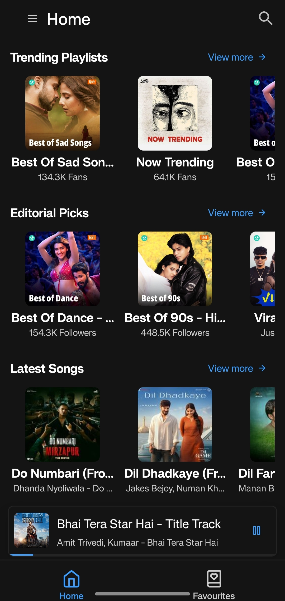

# Sleek

[](https://expo.dev)
[](https://reactnative.dev)
[](https://tamagui.dev)
[](https://github.com/doublesymmetry/react-native-track-player)
[](https://docs.expo.dev/versions/latest/sdk/sqlite/)
[](https://www.typescriptlang.org/)
[](LICENSE)

Sleek is a modern, open-source music streaming application designed for speed, elegant UI, and gapless playback. Built with React Native, Expo, Tamagui, and React Native Track Player.

---

## Table of Contents

- [Previews](#previews)
- [Features](#features)
- [Tech Stack](#tech-stack)
- [Getting Started](#getting-started)
- [Available Scripts](#available-scripts)
- [Quality and Languages](#quality-and-languages)
- [Contributing](#contributing)
- [License](#license)

---

## Previews

### Explore page



### Player


[More Previews](previews)
---

## Features

- **Audio Engine**: High-performance playback with background audio support, lockscreen controls, notification artwork, and headphone hardware remote control.
- **Smart Autoplay**: Continuously fetches and queues related tracks when the active playback queue ends.
- **Adaptive Streaming**: Choose between 320 kbps (Extreme), 160 kbps (High), 96 kbps (Standard), 48 kbps (Low), and 12 kbps (Saver) streaming quality.
- **Multilingual Music**: Filter and curate music recommendations across 16 Indian and international languages.
- **Rich Contents**: Browse Trending songs, albums, and playlists, Latest releases, and curated Top Charts.
- **Universal Search**: Search across Songs, Albums, Artists, and Playlists, Queue.
- **Plain Lyrics**: In-player lyrics viewer with formatted line rendering.
- **Queue Controls**: Full playback controls (Play, Pause, Skip Next/Previous, Seek scrubber with buffered progress, Shuffle, Repeat One, and Repeat All).
- **Mini-Player**: Bottom floating mini-player with swipe-to-expand player sheet.
- **Favorites**: Save favorite songs, albums, artists, and playlists locally with offline persistence using `expo-sqlite`.
- **Appearance**: Auto (System default), Dark (OLED-friendly dark theme), and Light modes built with Tamagui design tokens.

---

## Tech Stack

| Category         | Technology                                           |
| ---------------- | ---------------------------------------------------- |
| Framework        | Expo (SDK 55), React Native (0.83), React (19)       |
| UI System        | Tamagui v2, Lucide Icons (`@tamagui/lucide-icons-2`) |
| Routing          | Expo Router (Typed file-based routing)               |
| Audio Engine     | React Native Track Player (`@rntp/player`)           |
| Storage          | Expo SQLite (`expo-sqlite`)                          |
| State / Fetching | SWR (`swr`), Custom Preference Store                 |
| Tooling          | Bun, Oxlint, Oxfmt                                   |

---

## Getting Started

### Prerequisites

- [Node.js](https://nodejs.org/) (LTS) or [Bun](https://bun.sh/)
- Android Studio / Xcode configured with Expo Dev Client (native audio modules require custom builds)

### Setup and Run

1. Clone repository:

   ```bash
   git clone https://github.com/LakhindarPal/sleek-music.git
   cd sleek-music
   ```

2. Install dependencies:

   ```bash
   bun install
   ```

3. Launch development build:
   ```bash
   # Start bundler
   bun run start

   # Run on Android
   bun run android

   # Run on iOS
   bun run ios

   # Run on Web
   bun run web
   ```

---

## Available Scripts

| Script            | Command                      | Description                            |
| ----------------- | ---------------------------- | -------------------------------------- |
| `start`           | `bunx expo start -c`         | Start Metro bundler with cleared cache |
| `android`         | `expo start --android`       | Launch on Android device / emulator    |
| `ios`             | `expo start --ios`           | Launch on iOS simulator                |
| `web`             | `expo start --web`           | Launch local web preview               |
| `lint`            | `oxlint`                     | Run linter checks                      |
| `lint:fix`        | `oxlint --fix`               | Automatically fix lint issues          |
| `fmt`             | `oxfmt`                      | Format code using Oxfmt                |
| `fmt:check`       | `oxfmt --check`              | Check code format compliance           |
| `upgrade:tamagui` | `bunx npm-check-updates ...` | Update Tamagui packages                |

---

## Quality and Languages

<details>
<summary>View Streaming Quality Options</summary>

| Setting | Bitrate  | Profile  | Description          |
| ------- | -------- | -------- | -------------------- |
| `_320`  | 320 kbps | Extreme  | Maximum fidelity     |
| `_160`  | 160 kbps | High     | Balanced performance |
| `_96`   | 96 kbps  | Standard | Standard streaming   |
| `_48`   | 48 kbps  | Low      | Mobile data saver    |
| `_12`   | 12 kbps  | Saver    | Minimum bandwidth    |

</details>

<details>
<summary>View Supported Languages (16 Languages)</summary>

Hindi, Tamil, Telugu, English, Punjabi, Marathi, Gujarati, Bengali, Kannada, Bhojpuri, Malayalam, Urdu, Haryanvi, Rajasthani, Odia, Assamese.

</details>

---

## Contributing

1. Fork the repository.
2. Create a branch: `git checkout -b feature/your-feature`
3. Commit changes: `git commit -m "feat: add feature"`
4. Push to branch: `git push origin feature/your-feature`
5. Open a Pull Request.

---

## License

This project is licensed under the [MIT License](LICENSE).
